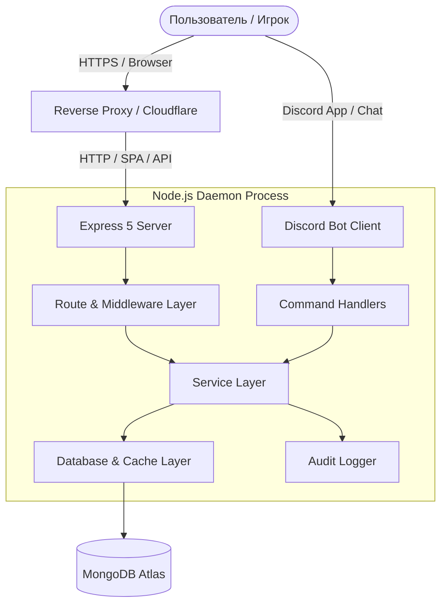
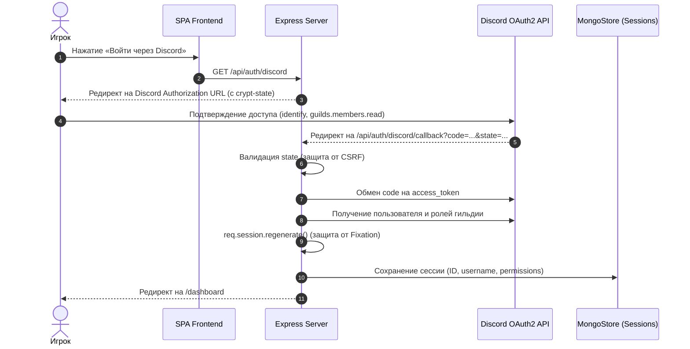
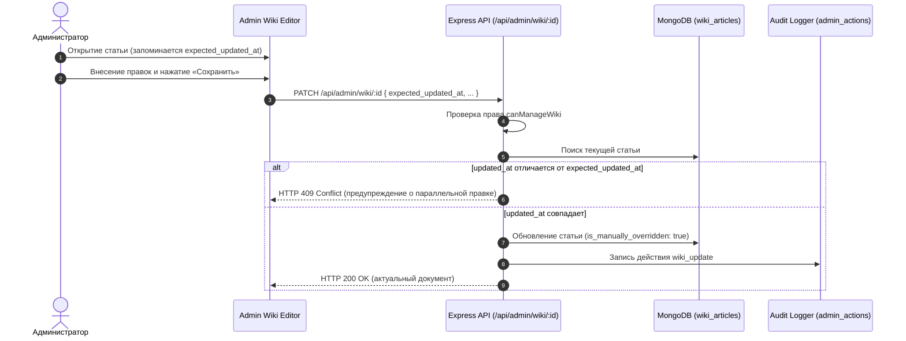

# Архитектура проекта Verge TRP (System Architecture)

Документ описывает структуру кода, архитектурные слои, потоки данных и принципы взаимодействия компонентов экосистемы **Verge TRP**.

---

## 1. Обзор архитектуры (System Overview)

Проект представляет собой монолитное модульное приложение на Node.js, объединяющее:
1. **Discord RPG Bot**: обработчик слэш-команд, модальных окон, кнопок и фоновых планировщиков.
2. **REST API Server (Express 5)**: JSON API для авторизации, игровых профилей, энциклопедии, анкет и администрирования.
3. **Web Portal (React + Vite)**: одностраничное приложение (SPA) с серверной отдачей бандла и OpenGraph метаинъекцией.
4. **Database (MongoDB Atlas)**: единая база данных `discord_bot` для бота и веб-интерфейса.



---

## 2. Архитектурные слои (Layering Model)

```
┌─────────────────────────────────────────────────────────────┐
│                       Presentation Layer                    │
│   React SPA (Vite)  │  Discord UI (Embeds & Components V2)  │
└──────────────────────────────┬──────────────────────────────┘
                               │
┌──────────────────────────────▼──────────────────────────────┐
│                    API & Controller Layer                   │
│   Express Routes (/api/*)   │   Discord Interaction Handler │
│   Auth, CSRF, RateLimit     │   Modal & Slash Command Router│
└──────────────────────────────┬──────────────────────────────┘
                               │
┌──────────────────────────────▼──────────────────────────────┐
│                        Service Layer                        │
│   playerService      │  inventoryService  │  wikiService    │
│   applicationService │  permissionService │  globalSearch   │
│   auditService       │  salaryService     │  authService    │
└──────────────────────────────┬──────────────────────────────┘
                               │
┌──────────────────────────────▼──────────────────────────────┐
│                      Data Access Layer                      │
│   MongoDB Native Driver  │  connect-mongo (Sessions Store)  │
│   In-Memory TTL Caches   │  Transactions & Schema Indexes   │
└─────────────────────────────────────────────────────────────┘
```

---

## 3. Сервисный слой (Service Layer)

Все операции с данными вынесены в изолированные сервисы в директории `services/`:

- **[`services/playerService.js`](file:///c:/Users/solok/OneDrive/Документы/verge-discord-bot/services/playerService.js)**:
  - Нормализация документов игроков (`normalizePlayer`).
  - Управление слотами персонажей (слот 1: `{id}`, слот 2: `{id}_2`).
  - Разрешение публичных слагов и профилей.
  - Санитизация данных: отделение публичных полей от приватных (балансы, служебные таймстампы).
- **[`services/inventoryService.js`](file:///c:/Users/solok/OneDrive/Документы/verge-discord-bot/services/inventoryService.js)**:
  - Чтение и группировка предметов инвентаря игрока.
  - Классификация по типам (`kind`: `ap` Тома AP, `sp` Свитки SP, `collectible` Особое/Коллекционное) и 5 уровням редкости (`common`, `uncommon`, `rare`, `epic`, `legendary`).
- **[`services/wikiService.js`](file:///c:/Users/solok/OneDrive/Документы/verge-discord-bot/services/wikiService.js)**:
  - Управление статьями энциклопедии канона.
  - Поддержка категорий (`WIKI_CATEGORIES`), генерация оглавлений (TOC).
  - Поиск по заголовкам, тегам, алиасам и содержимому.
  - Проверка происхождения (`provenance`) и защита ручных правок (`is_manually_overridden`).
- **[`services/applicationService.js`](file:///c:/Users/solok/OneDrive/Документы/verge-discord-bot/services/applicationService.js)**:
  - Парсинг и нормализация принятых анкет (`applications`).
  - Генерация безопасных DTO без раскрытия внутренних Discord ID и заметок кураторов.
- **[`services/permissionService.js`](file:///c:/Users/solok/OneDrive/Документы/verge-discord-bot/services/permissionService.js)**:
  - Расчет гранулярных возможностей (capabilities) пользователя на основе ролей и ID.
- **[`services/globalSearchService.js`](file:///c:/Users/solok/OneDrive/Документы/verge-discord-bot/services/globalSearchService.js)**:
  - Параллельный поиск по коллекциям `players`, `applications`, `wiki_articles`.
  - Весовая модель релевантности (100–15 баллов) и санитизация сниппетов.
- **[`services/auditService.js`](file:///c:/Users/solok/OneDrive/Документы/verge-discord-bot/services/auditService.js)**:
  - Запись административных действий в коллекцию `admin_actions` с маскированием паролей и токенов.
- **[`services/authService.js`](file:///c:/Users/solok/OneDrive/Документы/verge-discord-bot/services/authService.js)**:
  - Обмен OAuth2-кодов на токены Discord, проверка участия в официальной гильдии.

---

## 4. Потоки данных (Data Flows)

### 4.1. Авторизация через Discord OAuth2


### 4.2. Административное редактирование Wiki (с защитой от конфликтов)


---

## 5. Модель данных MongoDB (Collection Schemas)

| Коллекция | Назначение | Ключевые поля |
| :--- | :--- | :--- |
| `players` | Досье персонажей (слоты 1 и 2) | `id`, `slug`, `public_id`, `character_name`, `character_avatar`, `rank`, `organization`, `attribute_name`, `krw`, `yen`, `ap` |
| `user_settings` | Пользовательские настройки | `id` (Discord ID), `active_slot` (1 или 2) |
| `inventory` | Предметы игроков | `player_id`, `item_name`, `qty`, `category`, `description` |
| `player_sp` | Изученные боевые стили | `player_id`, `style_id`, `style_name`, `sp` |
| `applications` | Принятые квенты/анкеты | `slug`, `public_id`, `character_name`, `status` (`accepted`), `attribute_name`, `organization`, `sections` |
| `wiki_articles` | Энциклопедия лора | `slug`, `public_id`, `title`, `category`, `status` (`published`/`draft`/`archived`), `origin`, `is_manually_overridden`, `summary`, `content`, `tags`, `aliases` |
| `admin_actions` | Журнал аудита | `actor`, `action`, `entity_type`, `entity_id`, `changes`, `created_at` |
| `sessions` | Сессии пользователей | `_id`, `session`, `expires` (управляется `connect-mongo`) |

---

## 6. Фронтенд-архитектура (SPA)

- **Роутинг и Code Splitting**: Маршруты разделены через `React.lazy` и `Suspense`. Административные и второстепенные модули загружаются строго по требованию.
- **Состояние авторизации**: `AuthContext` предоставляет реактивный доступ к данным текущей сессии (`user`, `login`, `logout`, `switchSlot`).
- **Стилистическая система**: Построена на кастомных CSS Custom Properties (`--bg-core`, `--accent-purple`, `--accent-cyan`, `--text-main`) без тяжелых внешних UI-фреймворков.
