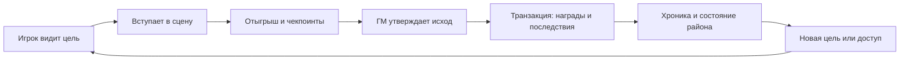

# Verge: ревью кода, рынок ТРП и приоритеты развития

Дата: **2 ноября 2026 года**. ТРП здесь означает текстовые ролевые проекты.
Снимок кода: `1f4f3ada782172f752a63f2894bb48cfc533186e`.

Это исходный аудит до исправлений. Результаты последующего дебаггинга и проверки перечислены в [журнале исправлений](DEBUGGING_2026-11-02.md).

## 1. Главный вывод

Verge уже объединяет реестр персонажей, прогрессию, экономику, организационные миссии и веб-портал. Это достаточная база для собственного ролевого проекта. Следующий большой шаг — связать действия игроков с историей мира: **найти сцену → отыграть → утвердить исход → получить проверяемые изменения персонажа и мира → увидеть новые возможности**.

Сейчас основной технический риск — неодинаковые гарантии надёжности разных подсистем. В магазине есть транзакции и идентификаторы операций, в зарплатах — атомарная защита по периоду, но выдача наград миссий и старые начисления AP/SP не обладают такими же гарантиями. Продуктовый риск — развивать количество механик быстрее, чем способность игроков находить партнёров, завершать сцены и понимать последствия своих действий.

В репозитории уже есть большой `BOT_DEVELOPMENT_PLAN.md` с правильным направлением: сцены, Скважины, заявки, канон, артефакты и фракции. Эти идеи не являются новым результатом данного исследования. Новый результат здесь — проверка актуального кода, воспроизведённые ошибки, внешнее сравнение и более узкий порядок реализации. Сам план частично устарел: он описывает 46 модулей команд, два слота и отсутствие тестов.

## 2. Что именно проверено

- Инвентаризация репозитория, загрузка всех модулей команд, документация, конфигурация и схема данных.
- Углублённое чтение авторизации и прав, персонажей и слотов, миссий, начислений, переводов, магазина, зарплат, аватаров, взаимодействий и поиска.
- Обзор связей Discord → БД → REST API → React, текущих игровых циклов и расхождений правил.
- Запуск штатного тестового набора, production-сборки фронтенда и двух аудитов зависимостей.
- Детерминированные локальные воспроизведения ошибок с изолированными подставными коллекциями; отдельно — реальный HTTP-запрос загрузчика аватара к временному локальному серверу.
- Исследование официальных страниц конкурентов и актуальной документации Discord/MongoDB.

Это обзор всех основных подсистем с углублением в наиболее рискованные потоки. Он не подтверждает отсутствие остальных ошибок. Производственная БД, реальные Discord-сессии, нагрузка и пользовательские когорты в проверке не участвовали. Воспроизведения с подставными коллекциями проверяют логику приложения, но не заменяют интеграционные испытания MongoDB replica set.

### Фактический снимок

| Проверка | Результат |
|---|---|
| Runtime проверки | Node.js `v22.22.2`, npm `10.9.7` |
| Команды | **59** загружаемых модулей, **59** уникальных имён |
| Тестовые файлы | **53** файла `*.test.js` |
| `npm test` | **338** тестов: **335 passed**, **0 failed**, **3 skipped**, около 20,4 с |
| Пропуски | Подготовка шрифта, покрытие кириллицы, PNG-карточка с кириллицей |
| `npm run web:build` | Успешно, около 6,8 с; основной JS 242,70 kB / 74,02 kB gzip |
| `npm audit --omit=dev`, корень | 6 затронутых пакетов: 1 critical, 3 high, 2 moderate |
| `npm audit`, каталог `web` | 5 затронутых пакетов: 2 high, 3 moderate; включает инструменты разработки |
| Канонические статьи | **30**, хотя некоторые документы говорят о 24 |
| CI | В отслеживаемых файлах `.github` workflow не обнаружен |
| Lock-файлы | Корневой `package-lock.json` отслеживается; `web/package-lock.json` не отслеживается |

Оценка npm относится к графу зависимостей. Метка critical не доказывает эксплуатацию конкретного приложения. Разные записи аудита могут относиться к транзитивным зависимостям и разным условиям использования; результаты двух каталогов нельзя просто складывать в число уникальных проблем.

## 3. Что уже сделано хорошо

1. **Есть предметная специализация.** AP/SP, ранги Tenryū и Стражей Мира, репутация, валюты, организации, собственный лор и Скважины дают основу для узнаваемого продукта.
2. **Есть полноценная экосистема.** Веб-портал объединяет досье, анкеты, инвентарь, Wiki, поиск и административные редакторы. Это полезнее ещё одной изолированной команды.
3. **Часть защиты реализована содержательно.** OAuth `state`, регенерация сессии после входа, серверное хранение сессий, HttpOnly/Secure cookies, ограничения запросов, CSRF-проверки и публичные DTO.
4. **Новые взаимодействия лучше старых collectors.** Сохранённые сессии, версии и атомарный захват защищают от части повторных нажатий и позволяют восстанавливать панели после рестарта.
5. **Экономические операции частично укреплены.** У переводов есть атомарные проверки баланса и транзакционный путь; у магазина — `operation_id`, ограничения, остатки и возвраты; у зарплат — период в документе персонажа.
6. **Миссии уже дают хороший каркас.** Набор, ограничения состава, организация, ранг, ветка, управление и награды позволяют развивать сцены поверх существующих сущностей.
7. **Тестовая база заметно выросла.** Проходящий набор полезен для изменений, но найденные ошибки показывают пробелы в проверке сбоев, конкуренции и интеграции подсистем.

## 4. Находки ревью

P1 — исправить перед расширением аудитории и запуском ценных новых механик. P2 — включить в ближайший технический этап. Это приоритеты исправления, а не оценки CVSS.

### F01 · P1 · Загрузчик аватаров допускает SSRF

**Где:** `utils/avatarStorage.js:73`, `:208`, `:235`; пользовательский вход — `commands/set-avatar.js`.

Проверяется текст hostname, но не фактически разрешённые IP-адреса. `localhost.` с завершающей точкой проходит проверку, хотя разрешается в loopback. Перенаправления `fetch` также не перепроверяются на каждом переходе. Публичный домен может разрешаться в приватный адрес.

**Воспроизведено:** временный локальный HTTP-сервер отдал тестовое PNG. `fetchImageBuffer("http://localhost.:<port>/avatar.png")` успешно получил 68 байт; сервер зафиксировал один запрос, валидатор вернул `true`.

**Последствие:** пользователь может инициировать запрос из окружения бота к внутреннему сервису. Произвольное содержимое не обязательно будет показано игроку: последующая проверка формата ограничивает сохранение, но сам сетевой запрос уже выполнен.

**Исправление:** предпочтительно принимать Discord-вложения и узкий список проверенных хостов. Если нужны произвольные URL — нормализовать имя, проверять все DNS-результаты, исключать непубличные адреса, привязывать соединение к проверенному адресу и контролировать каждый redirect. Лимит 8 МБ применять во время потокового чтения: сейчас весь ответ сначала попадает в `arrayBuffer()`.

### F02 · P1 · Повтор после сбоя может удвоить награды миссии

**Где:** `utils/missionStore.js:789`, `:876`, `:959`, `:1221`.

Награды изменяют персонажей и инвентарь отдельно, а весь `reward_delivery` сохраняется в конце. Если сохранение миссии не удалось после начисления, следующий запуск видит прежнюю миссию без отметки и повторяет начисление. `activeDeliveries` — память одного процесса: второй процесс имеет другой Set.

**Воспроизведено:** награда 100 KRW начислена; финальная запись миссии искусственно завершилась ошибкой; повтор вернул успех и довёл баланс до **200 KRW**. Для воспроизведения не требовался настоящий рестарт: достаточно сбоя финальной записи.

**Исправление:** операция награды с уникальным ключом `(mission, character, reward component)`, изменение баланса/инвентаря и фиксация факта выдачи — в одной транзакции. Случайного победителя сохранять до выдачи. Уведомления Discord отправлять после commit через outbox. Блокировка в БД может уменьшить конкуренцию, но сама по себе не закрывает промежуток между начислением и записью результата.

### F03 · P1 · Отозванные права сохраняются в веб-сессии

**Где:** `server/routes/auth.js:73–95`, `services/permissionService.js:74–82`, `server/app.js:133`.

Роли и вычисленные флаги `is_admin`, `is_staff`, `permissions.isAdmin` записываются при входе. Последующие проверки доверяют этому снимку. Повторного получения членства/ролей перед административными действиями нет. Удаление пользователя из роли или сервера не отзывает существующую сессию; cookie рассчитана на 14 дней.

**Последствие:** бывший сотрудник может сохранять административный доступ до истечения или уничтожения сессии. Изменение ENV-списка тоже не гарантирует отзыв, пока старый `is_admin` остаётся истинным.

**Исправление:** серверная проверка актуального членства и прав с коротким TTL; повторная обязательная проверка перед опасными изменениями; инвалидирование сессий при отзыве доступа. Старые булевы флаги не должны самостоятельно восстанавливать отозванные полномочия.

**Статус доказательства:** подтверждено чтением полного пути авторизации; отзыв роли на живом Discord-сервере не выполнялся.

### F04 · P1 · Роль с именем Game Master получает полные права администратора бота

**Где:** `utils/adminCheck.js:59–66`.

`isAdmin()` возвращает `true` по имени роли `Game Master`, без проверки её ID и без ограничения набором ГМ-команд. Этот результат используется и командами удаления персонажа, управления логами и другими административными функциями. Веб-права при этом рассчитываются иначе.

**Воспроизведено:** член с произвольным ID роли и именем `Game Master` получил `isAdmin === true` без Administrator permission.

**Исправление:** права только по разрешённым ID и явным capabilities; отделить ведущего от полного администратора; использовать одну политику для Discord, кнопок и веба. Название роли может быть подписью, но не источником доверия.

### F05 · P1 · Параллельные начисления AP/SP/репутации теряют обновления

**Где:** `utils/dataManager.js:531–587`, `:861–923`, `:2387–2416`.

Старые методы читают значение, рассчитывают новое и записывают его через `$set`. Два начисления могут прочитать один исходный баланс и перезаписать друг друга. Более аккуратные методы тренировок не защищают от параллельного вызова старого метода награды/админской выдачи.

**Воспроизведено для AP:** начальное 100; параллельные `addAP(+10)` и `addAP(+20)` без множителей; ожидается **130**, фактически **120**. Оба вызова сообщили результат.

**Исправление:** атомарное изменение значения (`$inc` либо update pipeline с ограничениями), единый журнал операций и получение before/after из атомарной операции. Для составной награды — транзакция. SP и репутация имеют аналогичный шаблон, но отдельное конкурентное воспроизведение для них не проводилось.

### F06 · P2 · Владелец третьего слота не распознаётся веб-API

**Где:** `services/playerService.js:163–174`, `server/routes/characters.js:97–103`.

Регистрация, переключение и `/grant-slot` поддерживают слот 3. `isCharacterOwner` принимает только `userId` и `userId_2`.

**Воспроизведено:** `isCharacterOwner({id: userId}, userId + "_3")` возвращает `false`. Обычный владелец получает публичное представление собственного третьего персонажа, а запрос его инвентаря через маршрут по slug будет отклонён с 403. Маршрут `/me` имеет отдельный путь, поэтому проблема может казаться непостоянной.

**Исправление:** единая проверка владельца для всех разрешённых слотов, лучше явные `owner_user_id` и `character_id`; тест маршрута третьего персонажа после его создания.

### F07 · P2 · Новый персонаж получает ссылку, которую БД не умеет разрешить

**Где:** `utils/dataManager.js:447–507`, `services/playerService.js:199–200`, `:348–361`.

`createPlayer` не сохраняет `slug` и `public_id`. Нормализация генерирует их для ответа на лету, но поиск публичного профиля ищет сохранённые поля. После разовой миграции новые регистрации снова создают документы без публичной идентичности.

**Воспроизведено:** документ нового персонажа без этих полей получил производные `novyy-geroy` и `ch_62b877c569`; поиск по каждому вернул `null`.

**Последствие:** ссылка из кабинета нового игрока может вести на 404 до повторной миграции или отдельного обновления документа; одинаковые имена также дают одинаковый временный slug.

**Исправление:** создавать стабильный public ID и уникальный slug при создании персонажа, а затем использовать их во всех DTO. Миграция нужна для старых данных, но не заменяет этот инвариант.

### F08 · P2 · Lore Master может редактировать Wiki по capability, но не попасть в панель

**Где:** `services/permissionService.js:77–84`, `server/routes/admin.js:71`.

`isLoreMaster` даёт `canManageWiki`, но не входит в `isStaff`. Общий guard требует `canAccessAdmin` раньше проверки конкретной возможности.

**Воспроизведено:** пользователь только с `LORE_MASTER_ROLE_IDS` получил `canManageWiki: true` и `canAccessAdmin: false`.

**Исправление:** доступ в панель должен следовать из наличия разрешённого административного раздела; отдельные разделы сохраняют собственные guards. Не выдавать редактору доступ к экономике ради обхода проблемы.

### F09 · P2 · Составные операции и рабочие сессии не полностью восстанавливаются после падения

**Где:** `utils/dataManager.js:1003–1035`, `utils/interactionSessions.js:129–155`, компенсирующие пути в `utils/shopStore.js` и хранилищах переводов.

SP-тренировка сначала записывает cooldown в `players`, затем начисляет SP в `player_sp`. Исключение откатывается, но завершение процесса между записями обходит `catch`: cooldown остаётся без награды. Захваченная сессия `working` не имеет lease и процедуры разбора после падения. Компенсация обычного исключения в переводе тоже не равна восстановлению после завершения процесса между debit и credit.

**Исправление:** транзакции для связанных документов; сохраняемые состояния операций; ограниченный по времени захват с владельцем и восстановлением. Возвращать зависшую платёжную сессию в `open` можно только после сверки результата операции, иначе можно создать повторное списание. Для ценных операций production предпочтителен обязательный транзакционный режим, а не тихое ухудшение гарантий.

**Статус доказательства:** структурные промежутки отказа подтверждены кодом; принудительное завершение настоящего процесса MongoDB/бота не выполнялось.

### F10 · P2 · Параллельные операции внутри одной транзакции MongoDB

**Где:** `utils/currencyTransferStore.js:95`, `utils/itemTransferStore.js:10`, `:27` — `Promise.all` с одной session.

Драйвер не поддерживает параллельные операции в одной транзакции. Текущие подставные коллекции это ограничение не моделируют. Нужно выполнять операции одной session последовательно и добавить интеграционный прогон переводов на replica set. Основание — [официальная документация MongoDB](https://www.mongodb.com/docs/drivers/node/current/crud/transactions/).

### F11 · P2 · Регистрация может пропустить срок первого ответа Discord

**Где:** `commands/register.js:186`, `utils/dataManager.js:469–478`.

При регистрации с аватаром `createPlayer` может скачивать изображение до первого `reply`, а раннего `deferReply` нет. Создание персонажа может завершиться, но игрок увидит ошибку взаимодействия и попробует повторить регистрацию. Discord требует первый ответ за 3 секунды; сетевой timeout загрузчика — 10 секунд. [Документация Discord](https://docs.discord.com/developers/interactions/receiving-and-responding).

**Исправление:** подтверждать получение команды до сети/долгих запросов, затем использовать `editReply`. Для открытия modal нужна отдельная быстрая ветка: modal нельзя просто открыть после произвольного отложенного ответа.

### F12 · P2 · Зависимости и сборка не соответствуют заявленному состоянию документации

**Где:** корневой и веб-графы зависимостей, `.gitignore`, `scripts/ensure-card-font.mjs:116`.

Корневой production-аудит пометил `proxy-addr` как critical, `body-parser`, `compression`, `undici` как high, `ip-address` и `qs` как moderate. Например, для `compression` опубликовано исправление в 1.8.2, а для `proxy-addr` — в 2.0.8. Это подтверждают [advisory compression](https://github.com/advisories/GHSA-vc2v-76pw-4v95) и [advisory proxy-addr](https://github.com/advisories/GHSA-jqcg-44mw-7w3h). Применимость отдельных advisory нужно проверить: числовой `trust proxy: 1` не равен уязвимой конфигурации доверенных подсетей из описания proxy-addr.

В `web` аудит выявил `vite`, `source-map-js`, `esbuild`, `react-router` и `react-router-dom`. Уязвимость dev-сервера Vite не означает такую же уязвимость статической production-раздачи. Обновлять надо с проверкой условий эксплуатации и совместимости, а не слепым `npm audit fix --force`.

`web/package-lock.json` не входит в Git, а `npm run build` запускает `npm install` внутри `web`: сборка может получать другие зависимости. Закрепить оба lock-файла и использовать воспроизводимую установку в CI.

Отдельно проверено Windows-сравнение entrypoint скрипта шрифта: `import.meta.url === file://${process.argv[1]}` ложно для Windows-пути. Скрипт может завершаться без вызова загрузки. Использовать `pathToFileURL`. В текущей проверке `CardFont.ttf` отсутствует, три соответствующих теста пропущены.

### F13 · P2 · Физические характеристики теряются между ботом и веб-порталом

**Где:** `utils/dataManager.js:366–379`, `services/playerService.js:185–189`, `:233–240`.

Команда регистрации физических показателей сохраняет вложенный объект `physical_stats`. Веб-нормализатор читает одноимённые значения из корня документа, а вложенный объект не использует. После успешной регистрации в Discord сайт может показывать отсутствие показателей либо старые значения плоской схемы.

**Воспроизведено:** переданы вложенные сила удара 120 кг, подъём 80 кг, скорость 25 км/ч, реакция 200 мс, стамина 130%. Веб-представление вернуло `is_registered: false`, числовые показатели `null` и стамину 100%.

**Исправление:** один нормализатор канонической схемы с явной поддержкой старых документов. Проверять сквозной сценарий «зарегистрировать через команду → получить профиль API», а не только каждый модуль отдельно.

## 5. Архитектура: что менять и чего достаточно на этом этапе

### Подходит сейчас

Node.js + discord.js + MongoDB + Express + React — подходящий стек для такого проекта. По результатам проверки нет основания начинать переписывание на другой язык или разносить всё на микросервисы. Модульный монолит проще поддерживать, пока команда небольшая.

### Требует укрепления

- `dataManager.js` — 2494 строки, `missionStore.js` — 1275, `shopStore.js` — 1006. Разделять стоит по обязанностям и инвариантам, а не ради числа файлов: progression, economy, characters, rewards, scenes, inventory, permissions.
- Discord и веб должны вызывать одни use cases. Сейчас часть бизнес-логики и нормализации дублируется; ограничения слотов уже разошлись.
- Нужны версии игровых правил: формулы, cooldown, шкалы AP/SP, зарплаты и представление Wiki должны ссылаться на одну конфигурацию. В канонической статье прогрессии ещё описан `/train` с шестью часами, а код использует `/train-ap` с пятью.
- Сохранённые операции и outbox важнее новой базы или дополнительного кеша. Сначала доказать, что награда применена один раз, затем отправить уведомление, допускающее повтор.
- Добавить CI: тесты, production-сборка, аудит, интеграционные экономические сценарии на replica set. Проверять недоступность БД, неизвестный результат commit, рестарт во время выдачи и восстановление очередей.
- Собирать latency команд, ошибки, задержку Gateway, event-loop lag, зависшие операции и время в очереди ГМ. Текущие health/readiness и console/logger — полезная основа, но не измерение пользовательского качества.
- Зафиксировать backup/restore и проверять восстановление копии. Наличие пункта `mongodump` в документации не подтверждает работающий процесс восстановления.

### Один сервер и продукт для многих серверов — разные задачи

Текущие `playerId = Discord ID + slot`, глобальный активный слот, настройки через ENV и серверные role ID удобны для одного мира. Общая прогрессия между серверами может быть намеренной, но сейчас нет явной модели независимых миров.

Перед публичным SaaS нужны `world_id/guild_id`, собственные character ID, составные индексы, изолированные настройки, права, экономика, поиск и файловое хранилище. Проверка должна охватывать каждый запрос, а не только карточки миссий. Установка в другой guild сегодня ещё не означает поддержку независимого ролевого проекта.

## 6. Продуктовый разбор ТРП

Это гипотезы о задачах аудитории, выведенные из устройства продукта и сравнения инструментов; интервью и телеметрия для Verge пока не предоставлены.

### Игроку нужно

Понять мир без чтения десятков страниц; создать принятого персонажа; быстро найти партнёра; знать доступный темп; не застрять из-за AFK; получить справедливый результат; видеть историю собственных решений.

### ГМ нужен

Понятный состав и состояние сцены, источники актуальных правил, скрытые заметки, контроль чекпоинтов, простое завершение с последствиями и выдачей, возможность передать сцену другому ведущему.

### Владельцу проекта нужны

Активация новичков, повторные игры, посильная нагрузка команды, воспроизводимые решения и непрерывность мира при смене стаффа. Число участников сервера, сообщений и команд не заменяет эти результаты.

### Основные текущие разрывы

1. Миссия уже организует набор и награду, но не является универсальной сценой с темпом, ходом, исходом и канонизацией.
2. AP/SP хорошо измеряются, но сами по себе не дают игроку новую сюжетную цель или утверждённую технику.
3. Wiki хранит канон, но игровой исход не превращается в связанную запись мира единым потоком.
4. Инвентарь в основном хранит название и количество. Уникальному артефакту нужны происхождение, владелец, состояния и история Слияния.
5. Зарплаты и магазин есть, но по коду нельзя установить фактическую доступность покупок и эффективность денежных расходов без данных об иных доходах.

### Проверка экономики на конкретном примере

При базовом множителе зарплаты Tenryū F получает 45 000 ¥ в неделю, S — 475 000 ¥. Том +25 AP стоит 20 000 000 ¥, эликсир 12 часов — 5 000 000 ¥.

| Предмет | Цена | Недель зарплаты F | Недель зарплаты S |
|---|---:|---:|---:|
| Том +25 AP | 20 000 000 ¥ | 444,4 | 42,1 |
| Эликсир +15%, 12 часов | 5 000 000 ¥ | 111,1 | 10,5 |

Это расчёт только по фиксированной зарплате, без миссий, торговли и административных наград; цены в живом каталоге БД могут быть изменены. Он не доказывает дисбаланс всей экономики. Он показывает, почему нужен отчёт по доходам и времени до первой значимой покупки. Возможна намеренная модель дорогих endgame-предметов, но тогда новичку нужны отдельные доступные цели.

Другие риски дизайна: минимум символов не проверяет связность RP, а сообщение в другом канале сбрасывает снижение тренировок независимо от его ролевой ценности. Усложнять автоматическую «оценку качества текста» вместо сценового подтверждения нецелесообразно. Лучше награждать завершённое взаимодействие с понятными лимитами и основанием.

## 7. Рынок и позиционирование

Ниже сравниваются предложения, а не доказанные доли рынка. Надёжной оценки TAM именно русскоязычных Discord-ТРП в использованных источниках нет. Нельзя превращать число серверов большого бота в количество потенциальных покупателей Verge.

| Категория | Пример и проверенное предложение | Вывод для Verge |
|---|---|---|
| Отыгрыш от лица персонажа | [Tupperbox](https://tupperbox.app/): профили, аватары, proxy/autoproxy, dashboard, редактирование сообщений | Полная замена требует отдельного продукта. В сценовом MVP достаточно явной привязки участника к персонажу |
| Автоматизация правил настольной игры | [Avrae](https://avrae.io/): броски, листы персонажей, инициатива, HP и состояния | Польза возникает от тесной связи с правилами. Для Verge это Атрибуты, техники, перегрузки, Скважины |
| Экономика сервера | [UnbelievaBoat](https://unbelievaboat.com/): доходы, магазин, игры, рейтинг, управление | Общая валюта и магазин уже широко доступны; история происхождения и сюжетные последствия могут выделять Verge |
| Социальная прогрессия и коллекции | [Tatsu](https://tatsu.gg/): XP, профили, предметы, торговля, питомцы и жильё | Косметика помогает выражать персонажа, но большой каталог требует постоянного производства контента |
| Мир и управление кампанией | [Kanka](https://kanka.io/), [World Anvil](https://www.worldanvil.com/): связанные сущности, записи мира, карты, хронологии и права | Wiki сама по себе не создаёт преимущества. Ценность Verge — применять исход сцены к связанному миру прямо из Discord |
| Ручной набор инструментов | Каналы Discord, сообщения стаффа, таблицы и отдельные документы | Это гипотеза основного практического конкурента: продукт должен сокращать ручную работу и число ошибок |

У соседних продуктов платные предложения уже существуют: [Tupperbox Premium](https://tupperbox.app/premium) продаёт дополнительные возможности профилей/лимиты; [Kanka](https://kanka.io/) показывает бесплатный базовый уровень и платные планы от $4.16 в месяц при годовой оплате. Это подтверждает наличие платной категории, но не платёжеспособный спрос на Verge или русскоязычные ТРП.

### Рекомендуемое предложение

**«Verge помогает вести общий ролевой мир в Discord: находить сцены, подтверждать последствия и сохранять историю решений персонажей».**

Первый сегмент для проверки — авторские супергеройские/городские RP-миры с устойчивым стаффом и несколькими одновременно идущими сценами. Это соответствует текущему лору. Порог 30–300 активных ролевиков можно использовать как критерий пилотного поиска, но это выбранный сегмент, а не измеренная статистика рынка.

Последовательность выхода: собственный мир → несколько внешних пилотов → конфигурация нескольких миров → самостоятельная установка. Запросы на поддержку чужих правил до проверки основного цикла могут поглотить всю разработку.

### Монетизация как проверяемая гипотеза

Возможные платные преимущества — брендирование портала, оформление досье, экспорт, расширенная история, инструменты команды и сопровождение. Базовая игра и справедливое применение правил должны оставаться полезными сами по себе. Продажа силы/AP усложнит и без того требующую проверки экономику.

В Discord предусмотрены подписки пользователя/сервера и разовые покупки, но доступ зависит от выполнения критериев приложения, команды и выплат. Это нужно проверить для конкретного владельца до проектирования оплаты. [Premium Apps](https://docs.discord.com/developers/monetization/overview), [условия включения](https://docs.discord.com/developers/monetization/enabling-monetization).

## 8. Что позволяет современный Discord

1. **Интерактивные карточки:** кнопки, списки и модальные формы подходят для набора, выбора цели, готовности и подтверждения результата. Verge уже использует Components V2; у них есть собственные ограничения совместимости полей сообщения. [Components](https://docs.discord.com/developers/components/overview).
2. **Сцены в ветках и форумах:** карточка с тегами, составом и состоянием; ветка хранит отыгрыш. Нужно учитывать архивирование и права участников. [Threads/Forums](https://docs.discord.com/developers/topics/threads).
3. **Расписание общих ивентов:** связывать карточку миссии с Scheduled Event; заинтересованность в событии и принятие в состав миссии учитывать отдельно. [Scheduled Events](https://docs.discord.com/developers/resources/guild-scheduled-event).
4. **Встроенная карта или пульт ГМ:** Discord Activities — веб-приложения в iframe с Embedded App SDK. Это подходит для совместной карты Скважины, доски улик или тактической схемы; React-портал нельзя просто открыть без адаптации авторизации, сетевого доступа и разрешений встраивания. Нынешние `frameAncestors: none` / `X-Frame-Options: deny` требуют отдельной архитектуры для Activity. [Activities](https://docs.discord.com/developers/activities/overview).
5. **Границы обработки сообщений:** `MESSAGE_CONTENT` и `GUILD_MEMBERS` — привилегированные intents. Актуальная документация описывает review при более чем 10 000 уникальных пользователей, которые могут видеть приложение на его серверах, и ежегодную повторную проверку доступа. Это не прежнее правило «просто перейти 100 серверов». Сценовый MVP с явными командами и ссылками меньше зависит от чтения всей переписки. [Gateway](https://docs.discord.com/developers/events/gateway).

## 9. Приоритетные идеи

Оценки ниже — инженерные ориентиры для одного опытного разработчика после устранения P1, с использованием текущего кода. Это оценки MVP, не обещание сроков production-запуска. Контент, правки правил и работа ГМ — отдельная нагрузка. Объёмы пересекаются и не складываются автоматически.

| Идея | Польза игроку | MVP | Приоритет |
|---|---|---:|---|
| Сцены и поиск партнёров | Быстрее начать и закончить игру | 2–3 недели | 1 |
| Первая Скважина с последствиями | Видимое изменение мира | 3–5 недель после сцен | 2 |
| Утверждённые техники Атрибута | Понятное применение прогрессии | 2–3 недели | 3 |
| Улики, секреты и знания персонажа | Настоящее расследование | 2–4 недели | 4 |
| Уникальные артефакты и Слияние | Предметы с собственной историей | 2–4 недели | 5 |
| Связи, обещания и долги | Поводы для RP между ивентами | 1–2 недели | 6 |
| Новости с разными взглядами фракций | Мир реагирует на игроков | 1–2 недели поверх world events | 7 |
| Ассистент ГМ по лору | Меньше времени на поиск и сводки | 1–3 недели после прав доступа | 8 |
| Карта/доска внутри Discord Activity | Совместный визуальный инструмент | 3–6 недель для ограниченного прототипа | Позже |

### 9.1. Сцена с договором темпа

Развить существующую миссию до общего сценария: `/scene open` → поиск по теме, времени, языку и темпу → выбор персонажа → вступление → ветка → чекпоинты → итог → подтверждение последствий.

До старта участники выбирают темп, допустимые ставки и способ завершения при AFK. Панель показывает ожидаемый ход и согласованный срок, позволяет объявить паузу или передать ведение. Напоминания — по выбранным настройкам, без массовых DM.

**Отличие от обычного LFG:** система отвечает за продолжение и завершение сцены. Для небольшого сообщества начать с простой доски и фильтров: сложный подбор не поможет при недостатке доступных партнёров.

### 9.2. «Цусима: обратный отсчёт» — первый игровой пилот

Сценарий для развития идей уже существующего плана, а не утверждение нового канона. У побережья обнаружена Скважина. Одновременно идут три направления: эвакуация гражданских, исследование Аномалии, получение образца Маджин. Несколько сцен влияют на общий набор показателей: безопасность, нестабильность, сведения о происхождении.

Если группа спасла людей, но потеряла образец, это должно открыть один исход. Если добыла образец ценой разрушения района — другой. Мир публикует утверждённый результат: изменённая локация, доступная зацепка, отношение фракции, новый контракт. Игрок видит конкретную связь со своей сценой.

Для MVP достаточно одного района, одной Скважины, трёх шаблонов сцен и нескольких заранее подготовленных исходов. Каждое изменение подтверждается ГМ; новые события не обязаны генерироваться самостоятельно.

### 9.3. Конструктор техник и сюжетный порог развития

Карточка техники: эффект, условия, стоимость сценового ресурса, ограничения, противодействие, доказательство/ссылка на сцену, версия и автор решения. Игрок подаёт заявку, анкетолог или ГМ возвращает её на доработку либо утверждает.

AP открывает право на следующий шаг, а профиль показывает уже разрешённые возможности. При 1000 AP появляется готовность к сюжетному условию Олицетворения; отдельная критическая сцена завершает путь. Так число превращается в игровую цель. Первым релизом не нужен автоматический симулятор всех способностей.

### 9.4. Два слоя мира: истина и то, что знает персонаж

ГМ хранит истинное устройство события, а персонажи получают отдельные улики: отчёт, показание, отпечаток энергии, предмет, слух. Улики имеют источник, доступ и степень достоверности. Их можно передавать в игре, сверять и прикладывать к расследованию.

Два отряда могут получить разные части истины. Обмен знаниями создаёт переговоры и конфликт интересов без искусственного соревнования за AP. Удобный интерфейс — личная доска улик и связанные сцены.

Ключевое техническое условие: права на знания действуют и в поиске, и в API, и в любых сводках ассистента. Один лишь скрытый канал не защищает информацию, если общий поиск раскрывает её текст.

### 9.5. Артефакт, который помнит владельцев

Артефакт — уникальный экземпляр: происхождение из конкретной Скважины, известные свойства, скрытая часть ГМ, история владельцев, изменения состояния и этапы Слияния. Смена владельца, травма, критическая сцена или отказ от силы могут стать частью его истории.

Пилот: три заранее созданных артефакта, несколько этапов Слияния, одно значимое решение вместо ежедневного нажатия. Предмет погибшего персонажа может перейти другому как сюжетное наследие, не передавая автоматически все характеристики прежнего владельца.

### 9.6. Связи, обещания, репутация у конкретных групп

Подтверждаемые связи «наставник», «должник», «соперник», «партнёр»; обещание имеет срок или условие и ссылку на сцену. Отношение фракции учитывается отдельно от публичной известности Rtg: знаменитость может быть неприемлемым союзником для конкретной организации.

Польза — устойчивые поводы играть с другими людьми. Исключить бесконечную награду за создание взаимных связей: отношения должны открывать действия и сюжетные поводы, а не становиться ещё одной формой фарма.

### 9.7. Газета мира и причинная хроника

После закрытия сцены ГМ утверждает факты. Из одного события можно подготовить публичную новость, внутренний отчёт Tenryū и слух синдиката: общие факты сохраняются, интерпретация и доступ отличаются.

Личная хроника показывает: «ты спас госпиталь → район сохранил медицинскую помощь → открылся контракт → союзник выжил». Это сильнее общей таблицы лидеров и помогает вернуться после перерыва. В первом варианте достаточно шаблонов и редактора; генеративная модель не обязательна.

### 9.8. Ассистент ГМ с проверяемыми источниками

Полезные функции: найти правило, показать конфликт версий, собрать черновик сводки по разрешённым материалам, предложить зацепки из утверждённых шаблонов. Ответ о правиле сопровождается ссылкой на статью и её версию; итог публикует ведущий.

Награды, канон и спорный исход не следует напрямую связывать с произвольным текстом модели. Секретные знания фильтруются до подготовки контекста. Экономические изменения выполняет обычный валидируемый сервис после явного подтверждения, а не инструкция из RP-текста.

## 10. Первый релиз, который стоит довести до конца

**Название рабочего пилота:** «Сцена оставляет след».

В составе: существующая миссия + выбор персонажа + договор темпа + три чекпоинта + итог ГМ + атомарный пакет наград/последствий + запись хроники + один изменяемый флаг района.

Готовность пилота: минимум 10 завершённых сцен с небольшой группой добровольцев; для каждой есть участники, исход, проверяемая выдача и след в мире. Повтор подтверждения и перезапуск не меняют награду. Игрок может объяснить, что именно изменилось из-за его решения.

## 11. План на 90 дней

Предположение: один разработчик с полноценной занятостью, доступный ГМ/владелец правил и небольшой пилотный состав. При иной загрузке сроки масштабируются. Переход между этапами определяется результатом проверки.

| Период | Работа | Условие выхода |
|---|---|---|
| Недели 1–2 | SSRF, награды, права, атомарность; владельцы слотов, публичные ID; lock-файлы/CI; минимальная телеметрия | Воспроизведения закрыты, нет дубля выдачи при повторе/сбое, отзыв роли реально прекращает доступ |
| Недели 3–5 | Сценовый MVP на базе миссий; `/me`; темп, пауза, итог; единый сервис наград | Можно провести сцену от набора до хроники без ручной цепочки выдач |
| Недели 6–8 | Один сюжетный пилот Скважины; флаги района; заранее подготовленные исходы | Пройдены 10 сцен; последствия понятны игрокам; измерена нагрузка на ГМ |
| Недели 9–12 | Исправления по данным; одна следующая система — техники **или** улики **или** артефакты | Выбор подтверждён использованием и обратной связью; подготовлен повторяемый контентный процесс |

Полная многосерверность, универсальный боевой движок и большой Activity не входят в обязательство этого цикла. Они становятся отдельными этапами, когда подтверждена польза основного продукта.

## 12. Как проверить идею и спрос

### Данные продукта

- Доля утверждённых новичков, вошедших в первую сцену за 72 часа; время до первого ответа партнёра.
- Сцены, закрытые с исходом / начатые сцены; время зависания и причины отмены.
- Участники, сыгравшие повторно в течение 7/30 дней. Считать по людям, отдельно от персонажей и количества сообщений.
- Минуты работы ГМ на подготовку и закрытие; очередь и возраст заявок.
- Повторные/ошибочные выдачи, незавершённые операции, обращения за ручным исправлением.
- Доходы по источникам, расходы, активные покупатели, время до доступной покупки, распределение богатства с учётом активности.

Сначала измерить baseline. Порог «60% новичков за 72 часа» или рост завершённых сцен — целевой эксперимент, а не уже наблюдённый показатель. При маленькой выборке показывать и абсолютные числа, и доли.

### Исследование рынка

1. Поговорить с 8–12 владельцами/ГМ авторских RP-проектов и 12–20 игроками, включая недавно ушедших. Это рекомендуемый план исследования, не выполненные интервью.
2. Попросить показать последнюю реально зависшую сцену, последний спор о награде и последние 30 минут рутинной работы. Проверять поведение, а не только желание иметь «крутого бота».
3. Запустить 3–5 пилотов после проверки собственного мира. Согласовать одно наблюдаемое улучшение и сравнить с исходной неделей.
4. Проверять готовность платить после использования: какие функции экономят время, нужен ли перенос данных, кто принимает решение, какой объём поддержки требуется.
5. Масштабировать, если внешние проекты регулярно пользуются основным циклом без ежедневного ручного сопровождения разработчика.

## 13. Практическая рекомендация

Первое инженерное действие — сделать гарантии выдачи и доступа одинаковыми во всех подсистемах. Первое продуктовое действие — провести одну сцену с проверяемым последствием в мире. Первая большая игровая особенность — Скважина, где решения разных групп меняют общий исход.

Сильная сторона Verge — собственная вселенная и возможность связать её лор с реальными действиями сообщества. Именно эту связь стоит сделать основной причиной пользоваться ботом и возвращаться в игру.
